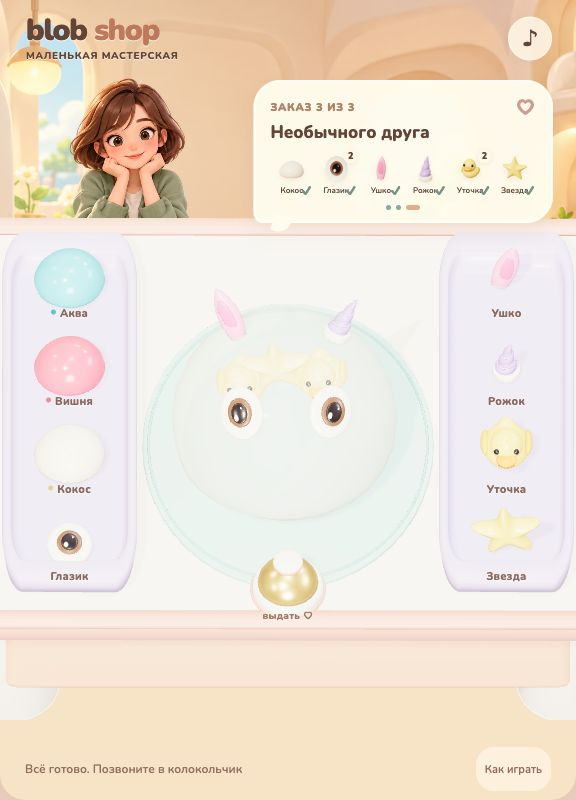

# Blob Shop

[Открыть игру](https://anotherrealityai.github.io/toon-games/blob-shop/?v=3) · [Исходники](https://github.com/anotherrealityai/toon-games/tree/main/blob-shop-source)

Мастерская мягких блобов: три заказа без таймера. Рабочая зона находится в центре, два лотка с добавками — по бокам. Клиентка пока остаётся неподвижной иллюстрацией.



## Как играть

- Переносите капсулы на блоба и отпускайте: материал меняет его цвет и физические свойства. «Кокос» тянется туже и сохраняет вылепленную форму.
- Прикрепляйте отдельные глазки, ушки и рожки в любой точке. Установленные глазки моргают и смотрят по сторонам. Бросайте уточек и звёздочки — внутри помещаются три игрушки.
- Мните и растягивайте тело мышью или двумя пальцами одновременно. Поворот возникает от физических воздействий; специальных режимов переноса и долгого нажатия нет.
- Видимый лишний предмет можно выбрать и вытянуть наружу. Его можно снова взять со стола и добавить обратно.
- Нажмите колокольчик, когда состав совпадёт с заказом. Корзина не нужна. Ошибка оставляет тот же заказ для исправления.

После трёх заказов доступен повтор. Перезагрузка страницы начинает с первого заказа.

## Запуск

Нужны Node.js 22.12+ и npm.

```sh
npm ci
npm run dev
npm test
npm run build
```

Dev: `http://127.0.0.1:5282/`. Сборка — `dist/`, с относительными путями и локальными ассетами/шрифтом. `?qa` включает только наблюдение за состоянием, без подстановки заказов.

`src/` — приложение и адаптер SoftBody; `assets/` — модели и изображения; `blender/source/props/` — редактируемые `.blend`; `blender/scripts/build_props.py` — моделирование и экспорт; `tests/` и `qa/` — проверки. Корзина сохранена среди исходных ассетов, но не загружается игрой. Nunito: `assets/fonts/OFL.txt`; уведомления о зависимостях: `public/THIRD-PARTY-NOTICES.txt`.

## Проверка версии0.3

14 тестов состава,12 групп регрессии физики и5 новых групп материала, независимых захватов и глаз прошли. Три обновлённых заказа пройдены мышью в production-сборке при ширине360px и повторно в обычном режиме. Проверены установка, снятие и возврат того же глазка, замена материала с сохранением добавок, ошибка и исправление. Финальная компоновка осмотрена при360×740,412×915,590×650,1280×800. Консоль:0 ошибок и0 предупреждений. Подробности — `docs/RELEASE-VERIFICATION.md`, доказательства — `qa/app/browser/v03/`.

Это тестовый прототип. Независимые захваты проверены автотестами физического адаптера; реальный телефон и одновременный touch в браузере ещё не проверены. Поглощение — управляемая траектория с контактным откликом; оболочка использует альфа-полупрозрачность без преломления, чтобы содержимое оставалось читаемым. Физика жидкости не моделируется.
