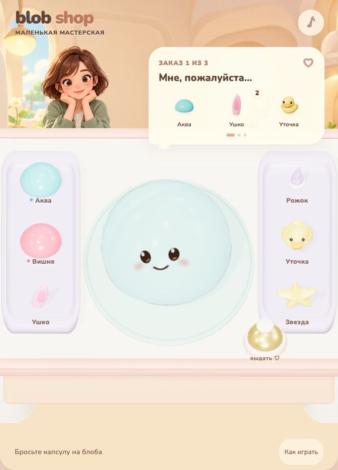

# Blob Shop

[Открыть игру](https://anotherrealityai.github.io/toon-games/blob-shop/?v=2) · [Исходники](https://github.com/anotherrealityai/toon-games/tree/main/blob-shop-source)

Мастерская мягких блобов: три заказа без таймера. Рабочая зона находится в центре, два лотка с добавками — по бокам. Клиентка пока остаётся неподвижной иллюстрацией.



## Как играть

- Переносите капсулы на блоба и отпускайте: материал меняет его цвет и физические свойства.
- Прикрепляйте ушки и рожки в любой точке. Бросайте уточек и звёздочки — внутри помещаются три игрушки.
- Мните и растягивайте тело мышью или пальцем. Поворот возникает от физических воздействий; специальных режимов переноса и долгого нажатия нет.
- Видимый лишний предмет можно выбрать и вытянуть наружу. Его можно снова взять со стола и добавить обратно.
- Нажмите колокольчик, когда состав совпадёт с заказом. Корзина не нужна. Ошибка оставляет тот же заказ для исправления.

После трёх заказов доступен повтор. Перезагрузка страницы начинает с первого заказа.

## Запуск

Нужны Node.js 22.12+ и npm.

```sh
npm ci
npm run dev
npm test
npm run build
```

Dev: `http://127.0.0.1:5282/`. Сборка — `dist/`, с относительными путями и локальными ассетами/шрифтом. `?qa` включает только наблюдение за состоянием, без подстановки заказов.

`src/` — приложение и адаптер SoftBody; `assets/` — модели и изображения; `blender/source/props/` — редактируемые `.blend`; `blender/scripts/build_props.py` — моделирование и экспорт; `tests/` и `qa/` — проверки. Корзина сохранена среди исходных ассетов, но не загружается игрой. Nunito: `assets/fonts/OFL.txt`; уведомления о зависимостях: `public/THIRD-PARTY-NOTICES.txt`.

## Проверка версии 0.2

13 тестов состава и 12 групп физики прошли. Все три заказа пройдены обычными мышиными жестами во встроенном браузере, включая production-сборку при ширине360px. Проверены лишний предмет, замена материала, вместимость, выборочное извлечение и возврат, повторный звонок и повтор игры. Консоль production-сборки: 0 ошибок, 0 предупреждений. Снимки и подробный отчёт — `qa/app/browser/`.

Это тестовый прототип. Реальный телефон и touch не проверены. Поглощение — управляемая траектория с контактным откликом; оболочка использует альфа-полупрозрачность без преломления, чтобы содержимое оставалось читаемым. Физика жидкости не моделируется.
