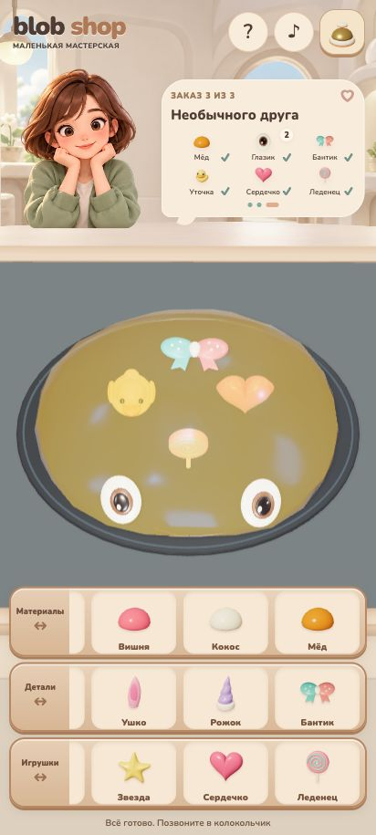

# Blob Shop

[Играть в v0.4](https://anotherrealityai.github.io/toon-games/blob-shop/?v=4) · [Исходники](https://github.com/anotherrealityai/toon-games/tree/main/blob-shop-source)

Мастерская мягких блобов: три заказа без таймера, большая рабочая зона и палитра «Сливочный графит».



## Как играть

- Двигайте фон или бортик нижнего лотка влево и вправо. Захват самого предмета сразу переносит его в любом направлении.
- Три категории по четыре предмета: материалы — Аква, Вишня, Кокос, Мёд; детали — глазик, ушко, рожок, бантик; игрушки — уточка, звезда, сердечко, леденец.
- Капсула меняет цвет и физическое поведение того же тела. Кокос сохраняет вылепленную форму, Мёд легко меняет её и постепенно расплывается сам.
- Глазки и детали ставятся в любую точку. Глазки моргают и смотрят по сторонам. Внутри помещаются три игрушки суммарно.
- Мните тело мышью или несколькими пальцами. Лишнее можно вытянуть наружу и вернуть в нижний лоток.
- Для выдачи нажмите звонок справа сверху. Ошибку можно исправить в том же заказе.

После трёх заказов есть повтор. Перезагрузка начинает первый заказ; сохранения нет. Клиентка пока статична.

## Запуск

Node.js 22.12+:

```sh
npm ci
npm run dev
npm test
npm run build
```

Dev: `http://127.0.0.1:5282/`. Сборка в `dist/`, относительные пути, локальные модели/шрифт/текстуры. `?qa` включает только просмотр состояния, без подстановки заказов.

## Проверка

35 проверок прошли: состав, физические регрессии, независимые захваты, глазки, Кокос и Мёд. Три заказа пройдены обычной мышью, включая окончательную сборку без QA. Проверены прокрутка трёх категорий, перенос предмета в любом направлении, новые добавки, извлечение леденца, точное сравнение и лимит трёх игрушек. Осмотрены 360×740, 412×915, 590×650, 1280×800; зоны предметов не меньше44px. Консоль:0 ошибок/предупреждений. Подробности — `docs/RELEASE-VERIFICATION.md`.

Пользователь подтвердил мультитач0.3 на телефоне; новые жесты лотков0.4 агентом на физическом телефоне не проверялись. Это прототип на частицах/пружинах, не полноценная симуляция жидкости. Поглощение и расположение игрушек управляемые; преломление отключено.

`src/` — приложение; `assets/` — модели/изображения/шрифт; `blender/source/props/` — редактируемые исходники; `blender/scripts/build_props.py` — моделирование и экспорт. Пять цветовых концептов: `art/concepts/v04-palettes/`. Nunito и зависимости: `assets/fonts/OFL.txt`, `public/THIRD-PARTY-NOTICES.txt`.
